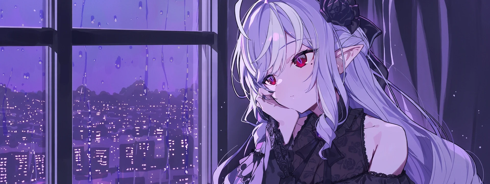

<!-- 색: 진보라 282345 · 보라 543F89 · 라벤더 9280CF · 연보라 C0A9E4 -->

<!-- 배너: assets/banner.webp 파일을 바꾸면 그림이 바뀌어요 -->

<!-- 타이핑 문구: https://readme-typing-svg.demolab.com/demo/ 에서 문구와 색을 넣고 만든 주소로 아래 src를 바꾸세요 (한글은 인코딩된 주소여야 GitHub에서 보여요) -->

<!-- 자기소개를 여기에 써 주세요 -->
야옹이
